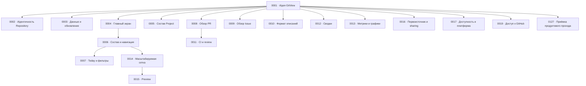

# Первый продуктовый проход: карта графа

Это обзор существующих продуктовых узлов и новой candidate-приёмки
[0127](GITVIEW-SPEC-0127.yaml). Стрелки ниже показывают **только `refines`**,
направленные для чтения от родителя к уточнению; это не изображение всех
`depends_on`. Полный граф с зависимостями остаётся в
[specification-graph-full](specification-graph-full.md).

`0127 depends_on` ссылается на продуктовые узлы 0002–0017 и 0019.
Это описание условий продуктовой ясности, не подтверждение их реализации.
[0018](GITVIEW-SPEC-0018.yaml) сохраняет календарь и более глубокий PR как
отложенные идеи. [0020](GITVIEW-SPEC-0020.yaml) и
[0021](GITVIEW-SPEC-0021.yaml) остаются приёмкой пилота и архитектурным
контекстом следующей стадии; они не являются зависимостями 0127.

Узлы 0022–0126 содержат смесь полезных продуктовых уточнений,
проверочных сценариев и технических кандидатов. Они не удалены и не
объявляются автоматически ненужными: пользовательское поведение можно
проследить к ним из [продуктовой проекции](product-first-pass-20261115.md),
а конкретные хранение, source requests, протоколы и concurrency choices
не становятся условием окончания первого продуктового прохода. Качества
DI, TDD и тестируемости остаются явно заданными ожиданиями разработки.

Эта карта — навигационная проекция, не новая ontology и не доказательство
полного semantic review. Открытые продуктовые вопросы и различие между
решениями владельца и агента указаны в 0127 и продуктовой проекции.
