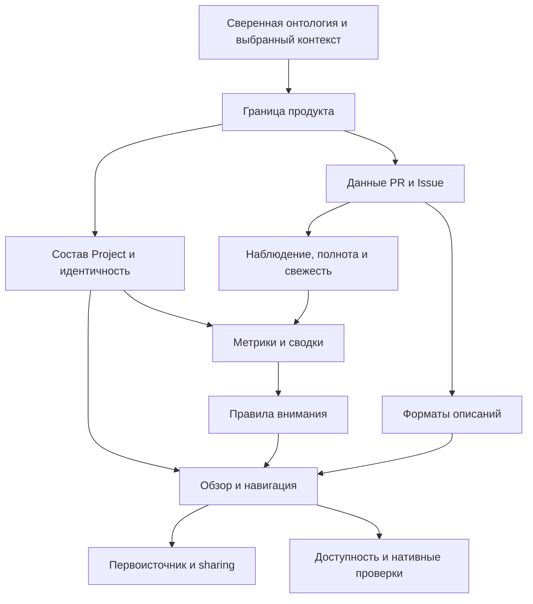

# Каркас покрытия спецификациями после сверки онтологии

Пользователь задал порядок работы: онтология, затем граф спецификаций
(`excerpt-52`). Для первого среза выбран составной `draft.4`
(`excerpt-59-reply`). [GITVIEW-SPEC-0002](GITVIEW-SPEC-0002.yaml) уточняет
[корневой черновик GITVIEW-SPEC-0001](GITVIEW-SPEC-0001.yaml) правилом
непрерывности идентичности при rename и transfer. Оба узла пока на рассмотрении
в `docs/drafts/`. Остальные строки ниже описывают будущие области требований.

Входы: [предметная модель](../../ontology/domain-model.md),
[матрица полноты](../../ontology/review/completeness.md), root intent и SpecDraft.
Spec ссылается на определённые термины/версии или явно сохраняет unresolved gap.
Ниже не заявлены прошедшие validation узлы или успешные bindings.

| Будущая область specs | Опорные понятия | Обязательства |
| --- | --- | --- |
| Граница продукта | GitView, User | Роль оператора, обзор, первоисточники и исключения. |
| Состав и идентичность | Project, Repository, GitHubRepository, GitHub | Default 1:1, пересечения, создание/изменение состава, устойчивые ссылки. |
| Данные объектов | PullRequest, Issue, ReviewThread, CIStatus | Выбранные поля, роли/ссылки, source mapping, состояния и unknown. |
| Содержание описаний | Issue, PullRequest; свойства Problem/Motivation/... | Формат, извлечение, происхождение заявлений, отсутствие/изменение разделов, обязательность. |
| [Наблюдение](GITVIEW-SPEC-0003.yaml) | GitHub, Repository, PullRequest, Issue | Черновик хранения наблюдений, чтения и обновления. Доступ, интервалы свежести и полнота загрузки требуют уточнения. |
| Метрики и сводки | Metric, Project, PR, Issue, CIStatus | Единицы, наборы, повторные запуски, периоды/история, уникальность, unknown. |
| Внимание | Review/CI/threads/blockers | Правила выборок и сочетания сигналов; нет молчаливого «зелёный = можно merge». |
| Обзор и взаимодействие | Project/Repository/PR/Issue | Область/плотность, фокус/возврат, Peek and Pop; скользящий preview и календарь со своим статусом объёма. |
| Первоисточник и sharing | Объект, URL, User | Открытие источника, состав sharing, private-контекст; без несогласованной записи в GitHub. |
| Доступность и платформа | Те же объекты и действия | Альтернативы жестам, VoiceOver, Dynamic Type, Reduce Motion, нативные проверки. |

## Зависимости для обсуждения

Это авторская схема подготовки, не подтверждение рёбер SpecGraph. Состав,
терминологическая ссылка и поведенческая зависимость различаются; схему нельзя
молча превратить в один тип `depends_on` и считать семантику сохранённой.

## Критерий полноты графа

Для каждого требования текущего объёма сохраняем источник/статус намерения,
область/obligation, термины и ontology context, предусловия, наблюдаемый результат,
unknown/error cases, acceptance examples, способ получить независимые evidence,
зависимости и исключения. Решение и прохождение проверки — разные статусы.

У каждого выбранного свойства Project/PR/Issue должно быть место, где оно
получается/используется или явно отложено; у каждой связи/роли — интерпретация;
у каждого принятого UX-сценария — критерий поведения над существующими объектами.
Отдельный ontology class для кнопки не требуется.

В `GITVIEW-SPEC-0002` зафиксированы сравнение числового REST `id` в пределах
одного сервера GitHub, повторное использование адреса и `404`
(`excerpt-60-reply`). Черновик `GITVIEW-SPEC-0003` опирается на эти правила
и на предположение о базе ранее полученных данных (`excerpt-61`). При ошибке
обновления интерфейс показывает время последнего успешного обновления и
явный признак ошибки GitHub (`excerpt-62`).
Для обновления предусмотрены фоновый запуск по возможности iOS, загрузка
при открытии устаревших данных (`excerpt-63`) и ручное обновление жестом
или действием, подходящим для экрана (`excerpt-64`). Замеры API, выбор
запросов и точные интервалы отложены до проектирования реализации
(`excerpt-65`).

Следующий шаг — спецификация обзора проекта: что видно сразу и как
пользователь переходит от обзора к отдельному PR или Issue.
